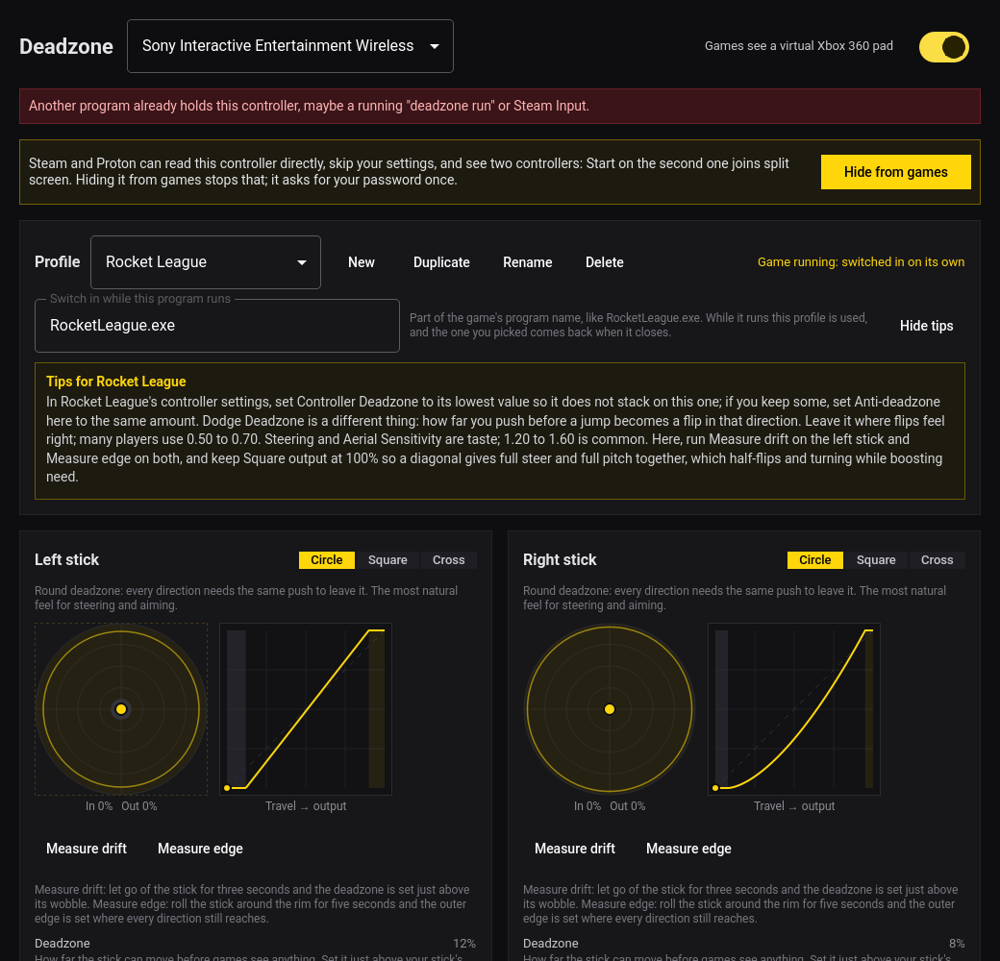

# Deadzone



Stick deadzones, response curves, and trigger ranges for Rocket League on
Omarchy, in the spirit of DS4Windows. Deadzone takes over the real
controller and hands the game a virtual Xbox 360 pad with your settings
applied. Rumble is passed back to the controller.

## Rocket League

- **Remap only while Rocket League runs**: outside the game the controller
  works as normal; Deadzone takes over the moment `RocketLeague.exe` starts.
- **Keep running without the window**: a systemd user service that starts at
  login. Together with the switch above, you never open Deadzone before
  playing.
- **Your in-game settings**: type in Controller Deadzone, Dodge Deadzone, and
  Steering and Aerial Sensitivity from the game, and Deadzone shows how they
  combine with yours: whether the two deadzones stack (with a button to
  cancel it), how far you push before flips go directional (a blue ring on
  the left stick), and where full steer and full aerial control arrive.
- **Trigger deadzone**: Rocket League adds its own deadzone to the triggers
  in `TAInput.ini`. Deadzone reads it from the game's Proton prefix and
  offers to cancel it with trigger anti-deadzone.
- **Session check**: play for 2, 5, or 10 minutes while Deadzone watches the
  controller. It shows heatmaps of where each stick spent its time and
  suggests changes with their reasons (drift at rest, reach in each
  direction, diagonal use, small versus full-tilt movement, trigger depth),
  each with an Apply button. It sees the controller, not the game.
- **Profiles** start from a preset: Standard, Freestyle (finer aerial
  control), or Worn stick (bigger deadzone, lower outer edge).

## What you can set

Each setting explains itself behind its info icon (`I` shows them all).

| Setting | What it does |
| --- | --- |
| Shape | **Circle**, **Square**, **Cross** (each axis alone), or **Custom**: drag eight handles to set how far the deadzone reaches in each direction. |
| Separate horizontal and vertical | Its own width and height: an oval, a rectangle, or two bands. |
| Deadzone | Below this the stick reads as centered, up to 100%. Output starts from zero at the edge, so there is no jump. |
| Anti-deadzone | The smallest output once you leave the deadzone, to cancel the game's own deadzone. |
| Outer edge | Past this the stick reads as fully pushed. |
| Diagonal reach | Lets diagonals reach full travel on both axes, like an Xbox stick; the DualShock 4 otherwise stops near 71% per axis. |
| Response | Presets (Linear, Soft center, Precise, Quick, S-curve, Two-stage), one exponent, or a curve drawn point by point. Vertical can get its own curve, for pitch in the air. |
| Triggers | Deadzone, outer edge, and anti-deadzone for each. |

**Measure drift** and **Measure edge** fit the deadzone and outer edge to
your stick.

## Shortcuts

| Key | Action |
| --- | --- |
| Space | Turn remapping on or off |
| P | Switch to the next profile |
| D | Show the next controller |
| I | Show every description under its setting |
| H | Hide the real controller from games |
| L | Next lightbar mode |
| R | Reset the profile to its preset |
| Esc | Stop measuring |
| Ctrl+Z / Ctrl+Shift+Z | Undo / redo |
| ? | Show shortcuts |
| Q | Quit |

## Lightbar and battery

The window shows the controller's battery, and the lightbar can stay as it
is, take one color, cycle through a rainbow, or show the battery level from
green to red. Setting it needs a one-time permission, added to the same udev
rule as hiding (it asks for your password). The controller gets its own
color back when Deadzone closes. `L` cycles the lightbar mode.

## Hiding the real controller

Steam and Proton read DualShock 4 and DualSense controllers through their raw
HID node, which skips Deadzone, so a game sees two controllers: Start on the
second one joins split screen. **Hide from games** installs
`/etc/udev/rules.d/72-deadzone.rules` (it asks for your password), which keeps
that node away from your user now and on every reconnect. Turn the
controller off and on once afterwards (unplug and replug the cable) so
programs that already opened it let go; the window ticks this off once
nothing has it open any more. With Deadzone closed, games still get the controller the ordinary way.
Turning the switch off removes the rule.

## Without the window

Turn on **Keep running without the window** in the Rocket League card, or
run `deadzone run` yourself. While the window is open it does the remapping
and the service waits; closing the window hands back to the service.
`deadzone list --json` shows what Deadzone can see.

## Building

```sh
bin/build      # build/deadzone
bin/test       # unit tests, offscreen
bin/install    # makepkg -fsi, adds it to the app launcher
```

Deadzone needs read access to `/dev/input/event*` and write access to
`/dev/uinput`. Steam's udev rules (or `game-devices-udev`) grant both to the
logged-in user.
